<div align="center">

# Clearance

**A self-hosted job search and resume workspace: a 350k-posting catalogue, evidence-backed resumes, and applications in one place.**

[](./LICENSE)
[](https://www.typescriptlang.org)
[](https://react.dev)
[](https://www.postgresql.org)
[](https://docs.docker.com/compose/)
[](#self-hosting)

[Live page](http://clearance.aakifmudel.xyz/) - [GitHub](https://github.com/ItsAakif/clearance) - [Features](#features) - [How it works](#how-it-works) - [Quick start](#quick-start) - [Self-hosting](#self-hosting) - [Screenshots](#screenshots) - [License](#license)

</div>

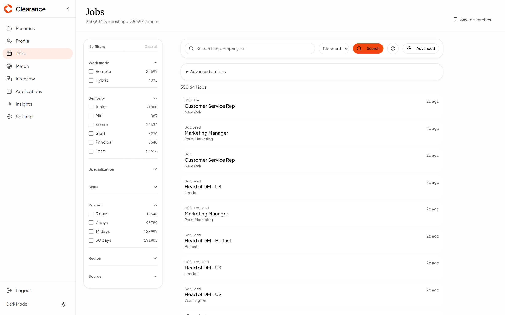

> Screenshot note: the images in `docs/screens/` were captured from a fictional demo profile, not from the owner's data.

---

## What this is

Clearance is a local-first workspace for one person's job search. It runs on your machine (or your own
server), signs you in with a single application password, and stores everything in **your own Postgres**.
There is no vendor account and no hosted backend: the catalogue, your profile, your resumes and your
applications live in a database you control.

AI is purely bring-your-own-key. You add a provider key in Settings when you want model assistance, and it
is encrypted at rest in your database. Every feature that does not need a model works without one.

It is built for one person managing their own search. It is not a multi-tenant SaaS.

## Features

- **Faceted catalogue search** over the swept ATS catalogue: full-text query plus facets for location, work
  mode, seniority, salary, company and source, with stable paging over a `searchDocument` built per posting.
- **Deep search with the ATS board sweep**: resolve company names to their ATS boards and sweep those
  boards directly, rather than only querying the catalogue.
- **Resume studio** with Typst and LaTeX template families, live preview, and server-rendered PDFs from the
  same document.
- **Evidence and claims layer**: a claim is a statement you have confirmed. Nothing unconfirmed enters a
  resume, and the studio shows you what is still unsupported.
- **Job match with named gaps**: match your profile to a posting and get the requirements it does not
  cover, by name, instead of a score.
- **Two-day project suggestions**: gaps become project proposals with a stack, references and a plan that
  fits a 16-hour budget.
- **Applications board and workspace**: stages, events, notes and the resume version you sent, per
  application.
- **Catalogue insights**: measured rollups over the catalogue (open roles, postings in the last 30 days,
  top skills, work mode, seniority, salary bands by region) with no model and no estimates.
- **Daily catalogue snapshots**: a GitHub Actions workflow sweeps one shard per ATS provider and
  publishes an excerpt-only snapshot as a GitHub Release; the app syncs it with one click from Settings
  or imports a downloaded snapshot locally.

## How it works

**Catalogue pipeline.** A company registry maps employers to ATS providers. A per-provider sweep walks
each provider's boards, normalises postings, dedupes them by `(source, externalId)` and `canonicalKey`,
and writes a derived `searchDocument` that search and facets read. The daily workflow (03:00 UTC) runs
the same sweep in shards, merges them, and publishes one snapshot per day.

**Render path.** A resume is a document, not a template string. The backend validates the document,
selects a Typst or LaTeX template, and asks a sandboxed render broker for a PDF. The broker compiles in a
separate container with no network, pinned toolchains and hard limits on time, memory and output size; the
backend never executes user content itself.

**Evidence gate.** Parsed statements become unconfirmed claims. Only confirmed claims are available to the
tailoring step, and the studio reports the requirements that remain unsupported, so a resume cannot
silently claim something you have not verified.

## Quick start

Prerequisites: Docker with Compose v2, and about 2 GB of free disk for the images.

```bash
git clone https://github.com/ItsAakif/clearance.git
cd clearance
cp .env.example .env
```

Set these in `.env` before the first start:

```env
POSTGRES_PASSWORD=<a strong database password>
CLEARANCE_ACCESS_PASSWORD=<your app password>
RENDER_BROKER_TOKEN=<a random shared secret for the render broker>
```

Then:

```bash
docker compose up -d --build
```

Open <http://localhost:8080> and sign in with the password you set.

Default password note: `CLEARANCE_ACCESS_PASSWORD` defaults to `CHANGEME` in `.env.example` and in the
Compose file. The app warns (and in production refuses to boot) while it is still the default, so set it
before the first start.

Checks: `curl http://localhost:3001/health` returns HTTP 200, and `curl http://localhost:8080` returns the
app shell. `VITE_*` values are baked at build time, so change them and rebuild.

## Configuration

Configuration is read from the repository-root `.env` (Compose passes it through). `backend/.env` is not
used.

| Variable | Required | Purpose |
| --- | --- | --- |
| `POSTGRES_USER` | no | Database user for the Compose `db` service. Defaults to `postgres`. Must match `DATABASE_URL`. |
| `POSTGRES_PASSWORD` | yes | Database password for the Compose `db` service. Defaults to `postgres`; change it. |
| `POSTGRES_DB` | no | Database name for the Compose `db` service. Defaults to `clearance`. |
| `DATABASE_URL` | yes | Postgres connection string used by Prisma. Defaults to the Compose `db` service. |
| `CLEARANCE_ACCESS_PASSWORD` | yes | The single application password. Defaults to `CHANGEME`. |
| `PORT` | no | API port. Defaults to `3001`. |
| `CLIENT_URL` | no | App origin used for CORS and links. Defaults to `http://localhost:8080`. |
| `API_URL` | no | Public API origin when it differs from the request host. |
| `RENDER_BROKER_TOKEN` | yes with the render tier | Shared secret between the API and the render broker. |
| `RENDER_BROKER_URL` / `RENDER_BROKER_SOCKET` | no | Broker transport. Compose uses a Unix socket; leave empty for the default. |
| `RENDER_STORAGE_KIND` | no | `fs` (implemented) or `s3` (fail-closed seam). Defaults to `fs`. |
| `RENDER_STORAGE_ROOT` | no | Where rendered artifacts are stored. Defaults to `backend/.artifacts`. |
| `RENDER_PER_USER_PER_MINUTE` | no | HTTP render budget per user. Defaults to `60`; can be lowered, not raised. |
| `RENDER_MAX_CONCURRENCY`, `RENDER_QUEUE_DEPTH`, `RENDER_TIMEOUT_MS` | no | Broker containment knobs. Defaults come from the policy module and cannot be raised. |
| `V2_TYPST_RENDER` | no | Enables the Typst/LaTeX render tier. Defaults to `false`. |
| `SWEEP_INTERVAL_HOURS` | no | In-process registry sweep interval. Defaults to `0` (disabled). |
| `CATALOGUE_FEED_URL` | no | Daily snapshot feed for the Settings sync button. Defaults to the latest GitHub release asset; loopback `http://` is accepted outside production. |
| `*_API_KEY` | no | Optional env fallback for AI and search providers. The normal path is BYOK in Settings, where keys are encrypted at rest. |
| `VITE_API_URL` / `VITE_APP_URL` | no | Frontend build values: API base URL, and the app origin for a separately hosted landing page. |

## Scripts

From the repository root:

| Script | Purpose |
| --- | --- |
| `npm run dev` | Vite dev server for the app. |
| `npm run build` | Production build of the app. |
| `npm run test` | Vitest suite for the frontend. |
| `npm run lint` | ESLint. |
| `npm run preview` | Serve the production build locally. |

From `backend/`:

| Script | Purpose |
| --- | --- |
| `npm run dev` | API with reload (tsx watch). |
| `npm run build` | Compile TypeScript and copy assets. |
| `npm run start` | Run the compiled API. |
| `npm run test` | Vitest suite for the backend. |
| `npm run db:generate` | Generate the Prisma client. |
| `npm run db:migrate` | Apply migrations in development. |
| `npm run db:push` | Push the schema without a migration. |
| `npm run db:studio` | Open Prisma Studio. |
| `npm run db:local` | Start the embedded local Postgres. |

Catalogue tooling (run with `npx tsx` from `backend/`):

| Script | Purpose |
| --- | --- |
| `scripts/sweep-all.ts` | Sweep the registry. Flags: `--batches`, `--boards`, `--max-rows`, `--minutes`, `--providers`, `--close`. |
| `scripts/export-catalogue.ts` | Export the catalogue as an excerpt-only snapshot. |
| `scripts/merge-catalogue.ts` | Merge per-provider shards into one snapshot and manifest. |
| `scripts/import-catalogue.ts` | Import a snapshot into a local database. |
| `scripts/import-company-registry.ts` | Load the company-to-ATS registry. |
| `scripts/probe-boards.ts` | Probe boards and report which providers answer. |

## Screenshots

| | |
| --- | --- |
| **Jobs** - faceted catalogue search | **Resume studio** - document outline, live A4 preview and template choice |
|  | 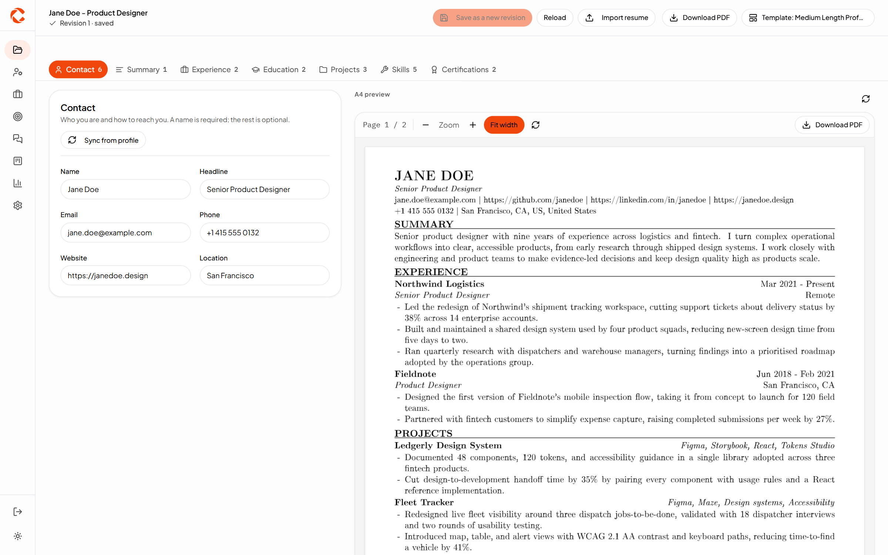 |
| **Profile** - the evidence-backed career record | **Job match** - requirements met and named gaps |
| 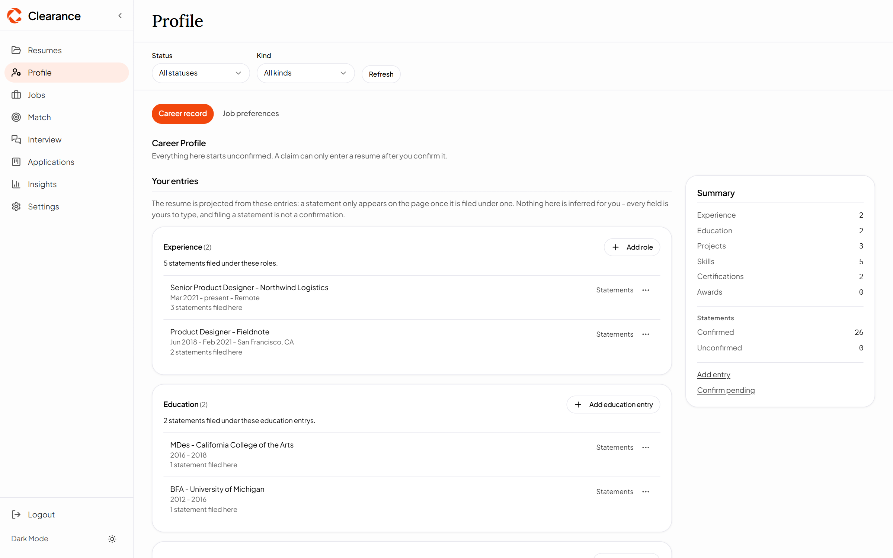 | 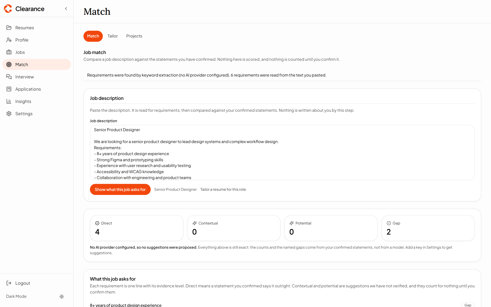 |
| **Projects** - two-day project suggestions for the gaps | **Applications** - the board by stage |
| 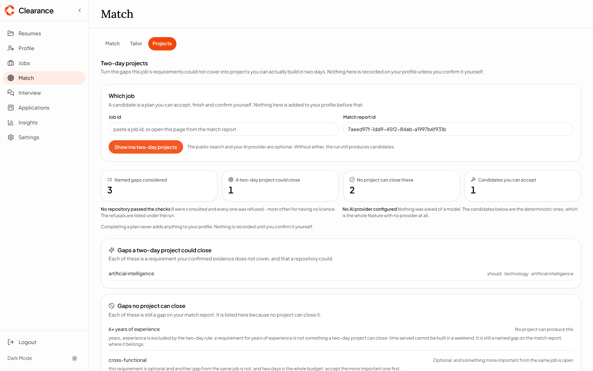 | 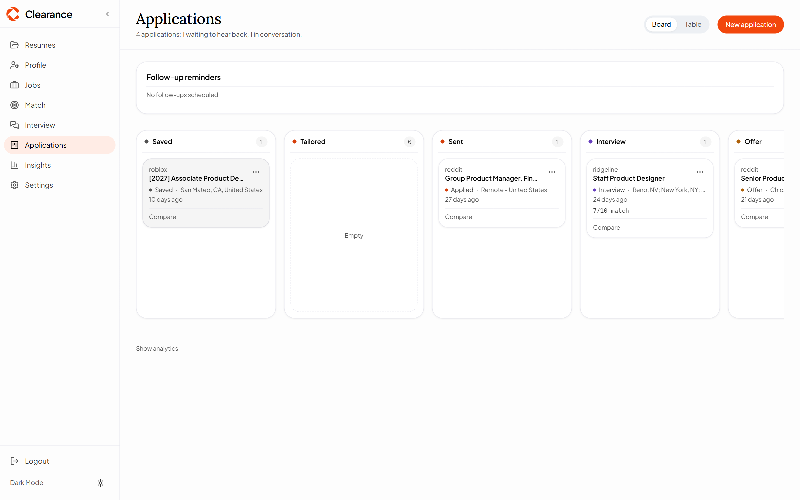 |
| **Application workspace** - events, notes and the resume version sent | **Insights** - measured catalogue rollups |
| 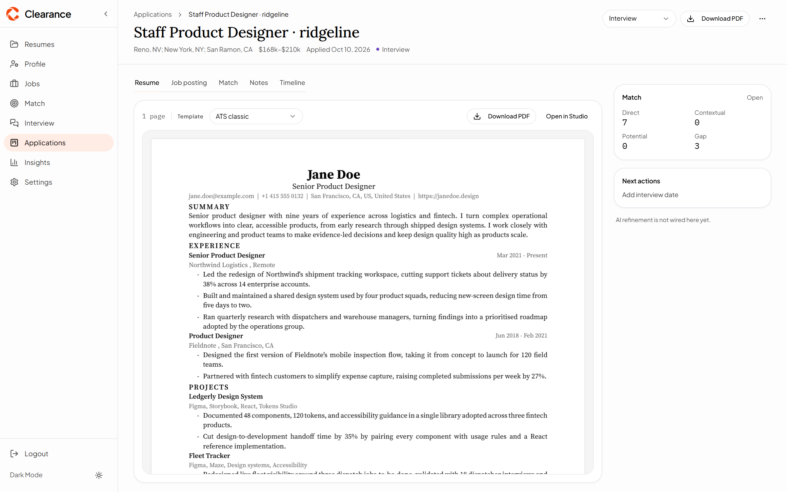 | 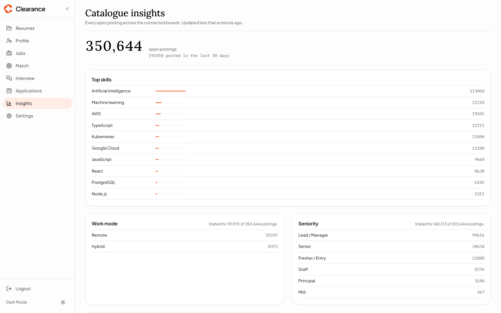 |
| **Interview prep** - derived risks with their rows | **Settings** - access password, AI provider keys and catalogue sync |
| 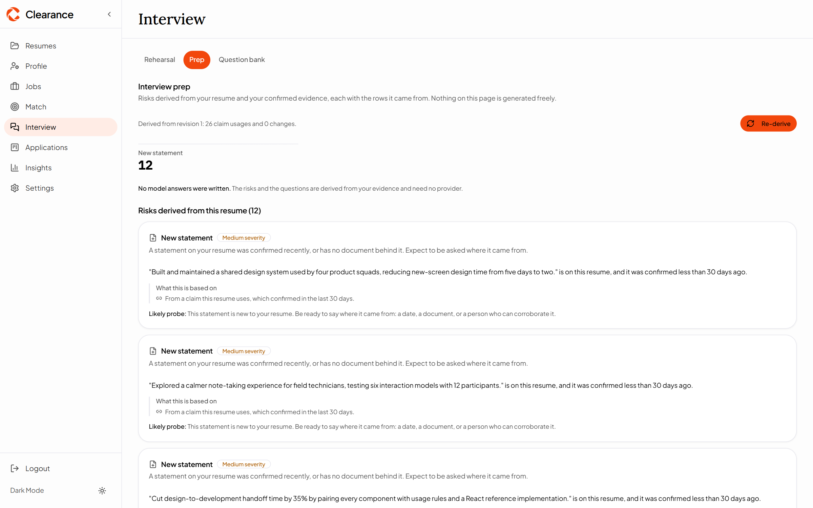 | 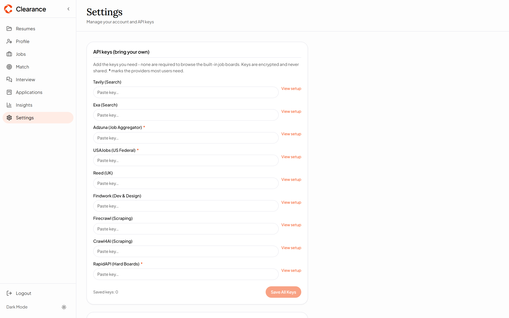 |
| **Job preferences** - target roles, seniority and salary | **Question bank** - hand-written interview answers |
| 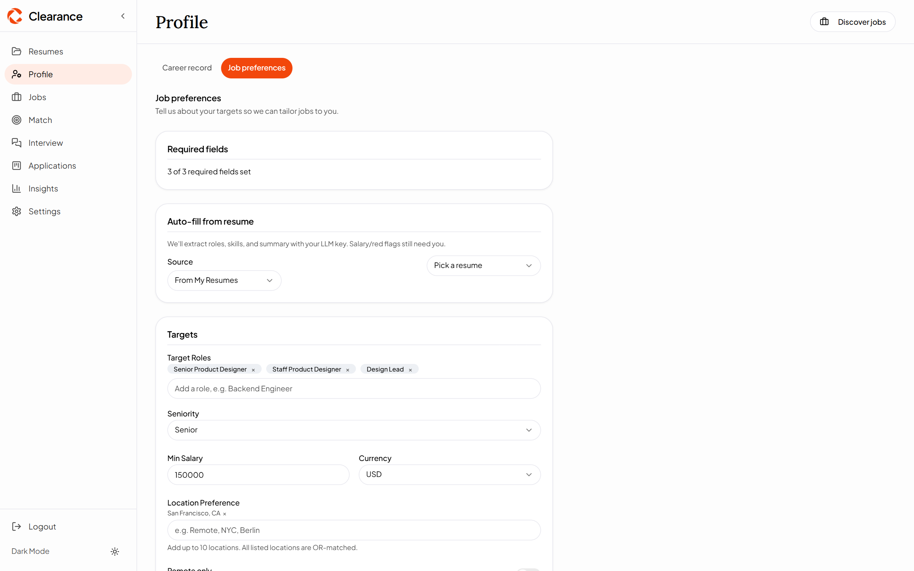 | 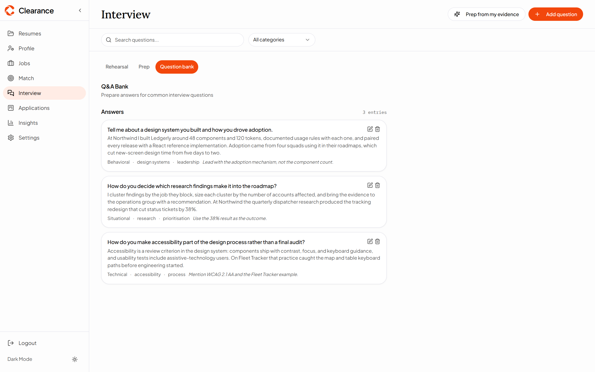 |

## Self-hosting

Compose runs four services: `db` (Postgres 16), `backend` (API; applies migrations before serving),
`frontend` (the built bundle behind nginx with SPA fallback) and the render broker with its worker images.
Only the frontend port is published by default.

- Keep the Postgres volume. It holds everything; a lost volume is a lost workspace.
- Set `DATABASE_URL` and `POSTGRES_*` to the same credentials. If you point `DATABASE_URL` at a hosted
  Postgres (Neon, Supabase), keep the pool small; the app appends conservative pool parameters when they
  are missing.
- Set `RENDER_BROKER_TOKEN` to a random value. The broker refuses to start without it.
- Put TLS in front of the app if it is reachable from outside your machine, and treat the access password
  as the only gate.
- Back up by dumping the database; rendered artifacts are reproducible from documents.

## Known limitations

- **Single user.** One application password, one profile. There are no accounts, roles or sharing.
- **AI features need a provider key.** Matching, tailoring and project suggestions degrade to their
  deterministic paths without one, and model-backed features stay off until you add a key.
- **Catalogue freshness depends on the workflow.** The snapshot is published daily by GitHub Actions; if
  the workflow is disabled or a provider changes its API, the catalogue is as fresh as the last run.
- **Desktop-first.** The interface targets a desktop browser; narrow windows work but are not the design
  target.
- **Render tier is opt-in.** With `V2_TYPST_RENDER=false`, PDF rendering through Typst/LaTeX is disabled.

## License

[MIT](./LICENSE). Use it, fork it, self-host it.

